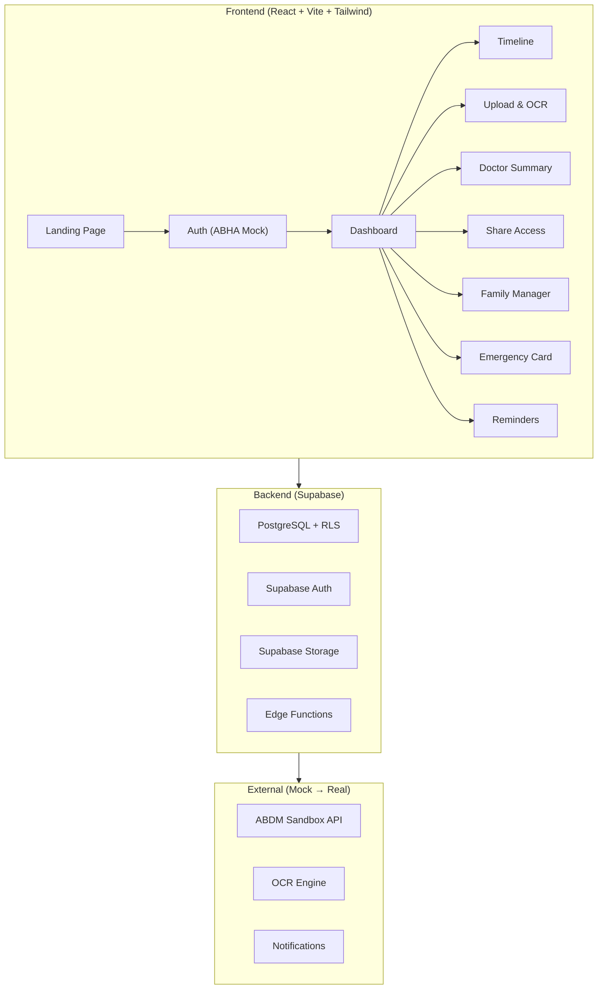

# Kaya (काय) — LifeChart: Lifelong Health Timeline for India

**Project Name:** `kaya` (Sanskrit for "body")  
**Tagline:** Your body's story, from birth to now.  
**Positioning:** A patient-friendly layer on top of India's ABDM/ABHA — digitises old paper records, shows a simple Hindi/English timeline, and gives doctors instant summaries.

---

## User Review Required

> [!IMPORTANT]
> **OCR Strategy**: Tesseract.js alone has ~20-40% accuracy on handwritten Indian prescriptions. The plan uses a **two-tier approach**: Tesseract.js for printed text with a structured "manual-entry-assisted" review form, plus clearly marked integration points for Google Cloud Vision / Gemini API for production. Is this acceptable for the MVP, or do you want cloud OCR from day one?

> [!IMPORTANT]
> **Supabase vs. Firebase**: The plan uses Supabase (PostgreSQL + Storage + Auth) as you specified. Supabase's free tier allows 500MB database + 1GB storage + 50K monthly active users. Confirm this is your target backend.

> [!WARNING]
> **ABDM Integration**: Real ABDM sandbox requires registration at sandbox.abdm.gov.in with Client ID/Secret and RSA encryption. The MVP will use **mock ABDM data** with clearly marked hooks (`// ABDM_INTEGRATION_POINT`) for real API calls later. This is the correct approach for an MVP — agreed?

## Open Questions

1. **Voice Input**: The Web Speech API works well for English but has limited Hindi accuracy in many browsers. Should we include it as a best-effort feature with a fallback manual input, or defer it to Phase 2?
2. **Notifications/Reminders**: For medicine reminders and vaccination alerts, should we use browser notifications (PWA-style) or is email/SMS planned for later?
3. **Deployment**: Planning to deploy on Vercel (free tier, great for React+Vite). Any preference for hosting?
4. **Logo/Branding**: Should I generate a logo for Kaya, or do you have one in mind?

---

## Architecture Overview



---

## Proposed Changes

### Phase 1: Project Foundation

#### [NEW] Project scaffolding and configuration

```
C:\Users\Lenovo\.gemini\antigravity\scratch\kaya\
├── index.html
├── package.json
├── vite.config.js                   # Includes @tailwindcss/vite plugin (no tailwind.config needed in v4)
├── .env.example
├── .gitignore
├── public/
│   ├── favicon.svg
│   └── manifest.json
├── src/
│   ├── main.jsx
│   ├── App.jsx
│   ├── index.css                    # Tailwind base + custom medical theme
│   ├── lib/
│   │   ├── supabase.js              # Supabase client init
│   │   ├── constants.js             # App constants, ABDM endpoints
│   │   └── utils.js                 # Shared utilities
│   ├── hooks/
│   │   ├── useAuth.js               # Auth state management
│   │   ├── useRecords.js            # Health records CRUD
│   │   ├── useTimeline.js           # Timeline data + filtering
│   │   ├── useConsent.js            # Consent/sharing logic
│   │   ├── useFamily.js             # Family member management
│   │   └── useLanguage.js           # i18n helper hook
│   ├── contexts/
│   │   ├── AuthContext.jsx          # Auth provider
│   │   └── LanguageContext.jsx      # Language provider
│   ├── services/
│   │   ├── abdm.js                  # ABDM mock service (// ABDM_INTEGRATION_POINT)
│   │   ├── ocr.js                   # OCR processing service
│   │   ├── records.js               # Records CRUD operations
│   │   ├── consent.js               # Consent management
│   │   └── notifications.js         # Reminders service
│   ├── components/
│   │   ├── ui/                      # Reusable UI primitives
│   │   │   ├── Button.jsx
│   │   │   ├── Card.jsx
│   │   │   ├── Modal.jsx
│   │   │   ├── Input.jsx
│   │   │   ├── Badge.jsx
│   │   │   ├── Alert.jsx
│   │   │   ├── Spinner.jsx
│   │   │   ├── LanguageToggle.jsx
│   │   │   └── VoiceInput.jsx
│   │   ├── layout/
│   │   │   ├── Header.jsx
│   │   │   ├── BottomNav.jsx        # Mobile bottom navigation
│   │   │   ├── Sidebar.jsx          # Desktop sidebar
│   │   │   └── PageLayout.jsx
│   │   ├── timeline/
│   │   │   ├── TimelineView.jsx
│   │   │   ├── TimelineEvent.jsx
│   │   │   ├── TimelineFilters.jsx
│   │   │   └── RecurringAlert.jsx   # "You had this before" alert
│   │   ├── upload/
│   │   │   ├── FileUploader.jsx
│   │   │   ├── OCRPreview.jsx
│   │   │   ├── ExtractedDataForm.jsx
│   │   │   └── ReviewConfirm.jsx
│   │   ├── doctor/
│   │   │   ├── QuickSummary.jsx
│   │   │   └── SimilarIllness.jsx
│   │   ├── consent/
│   │   │   ├── ShareQRCode.jsx
│   │   │   ├── ShareCodeInput.jsx
│   │   │   ├── ConsentManager.jsx
│   │   │   └── AuditLog.jsx
│   │   ├── family/
│   │   │   ├── FamilyList.jsx
│   │   │   ├── AddMember.jsx
│   │   │   ├── VaccinationTracker.jsx
│   │   │   └── ChildProfile.jsx
│   │   ├── emergency/
│   │   │   ├── EmergencyCard.jsx
│   │   │   └── EmergencyQR.jsx
│   │   └── reminders/
│   │       ├── MedicineReminder.jsx
│   │       └── FollowUpReminder.jsx
│   ├── pages/
│   │   ├── LandingPage.jsx
│   │   ├── LoginPage.jsx
│   │   ├── DashboardPage.jsx
│   │   ├── TimelinePage.jsx
│   │   ├── UploadPage.jsx
│   │   ├── DoctorSummaryPage.jsx
│   │   ├── ShareAccessPage.jsx
│   │   ├── FamilyPage.jsx
│   │   ├── EmergencyCardPage.jsx
│   │   └── RemindersPage.jsx
│   ├── data/
│   │   ├── mockPatient.js           # Realistic Indian patient mock data
│   │   ├── mockRecords.js           # 15+ years of health records
│   │   ├── mockABDM.js              # Mock ABDM fetch responses
│   │   ├── mockDoctors.js           # Mock doctor profiles
│   │   └── vaccineSchedule.js       # India NIS vaccine schedule
│   └── locales/
│       ├── en/
│       │   ├── common.json
│       │   ├── dashboard.json
│       │   ├── timeline.json
│       │   ├── upload.json
│       │   ├── doctor.json
│       │   ├── consent.json
│       │   ├── family.json
│       │   └── emergency.json
│       └── hi/
│           ├── common.json
│           ├── dashboard.json
│           ├── timeline.json
│           ├── upload.json
│           ├── doctor.json
│           ├── consent.json
│           ├── family.json
│           └── emergency.json
```

**Key dependencies:**
| Package | Version | Purpose |
|---|---|---|
| `react` + `react-dom` | ^19.x | UI framework (ViewTransition, useActionState) |
| `react-router-dom` | ^7.x | Client-side routing |
| `@supabase/supabase-js` | ^2.117.x | Supabase client (Auth, DB, Storage) |
| `@tailwindcss/vite` + `tailwindcss` | ^4.x | Utility-first CSS (Vite plugin, no config file) |
| `react-i18next` + `i18next` | ^17.x / ^24.x | Hindi/English i18n |
| `i18next-browser-languagedetector` | ^8.x | Auto language detection |
| `i18next-http-backend` | ^3.x | Lazy-load translation JSON files |
| `qrcode.react` | ^4.x | QR code generation (SVG + Canvas) |
| `tesseract.js` | ^7.x | Client-side WASM OCR (Web Worker) |
| `lucide-react` | ^1.x | Medical-friendly icon set |
| `date-fns` | ^4.x | Date formatting (lightweight) |
| `zod` | ^3.x | Runtime schema validation (forms, OCR output) |
| `react-hot-toast` | latest | Toast notifications |
| `framer-motion` | latest | Smooth animations |
| `recharts` | latest | Health data charts |
| `html5-qrcode` | latest | QR code scanning (camera) |

> [!TIP]
> **Tailwind v4 critical note**: Do NOT create `tailwind.config.js` or `postcss.config.js`. Tailwind v4 uses `@import "tailwindcss"` in CSS with `@theme {}` blocks for customization, via the `@tailwindcss/vite` plugin.

---

### Phase 2: Design System & Theme

#### [NEW] Medical-grade design tokens

**Color palette** (Teal + White, trustworthy medical feel):
```
Primary:      #0D9488 (teal-600)     — trust, health
Primary Dark: #0F766E (teal-700)     — hover states
Accent:       #F59E0B (amber-500)    — alerts, warnings
Success:      #10B981 (emerald-500)  — confirmations
Danger:       #EF4444 (red-500)      — critical alerts
Background:   #F0FDFA (teal-50)      — light teal tint
Surface:      #FFFFFF                 — cards, modals
Text:         #1E293B (slate-800)    — primary text
Text Muted:   #64748B (slate-500)    — secondary text
```

**Typography:**
- Hindi: `Noto Sans Devanagari` (Google Fonts)
- English: `Inter` (clean, medical)
- Base size: `18px` (elderly-friendly)
- Line height: `1.6` (readability)

**Spacing:** Large tap targets (min 48px), generous padding, clear visual hierarchy.

---

### Phase 3: Database Schema (Supabase)

#### [NEW] `supabase/schema.sql`

Core tables with Row Level Security:

```sql
-- Users/Profiles (extends Supabase auth.users)
CREATE TABLE profiles (
  id UUID PRIMARY KEY REFERENCES auth.users(id),
  abha_number TEXT UNIQUE,           -- 14-digit ABHA number
  abha_address TEXT,                 -- user@abdm
  full_name TEXT NOT NULL,
  full_name_hi TEXT,                 -- Hindi name
  date_of_birth DATE,
  gender TEXT CHECK (gender IN ('male','female','other')),
  blood_group TEXT,
  phone TEXT,
  emergency_contact_name TEXT,
  emergency_contact_phone TEXT,
  preferred_language TEXT DEFAULT 'en',
  role TEXT DEFAULT 'patient' CHECK (role IN ('patient','doctor','family_manager')),
  hpr_id TEXT,                       -- Healthcare Professionals Registry ID (doctors)
  created_at TIMESTAMPTZ DEFAULT NOW(),
  updated_at TIMESTAMPTZ DEFAULT NOW()
);

-- Family Members (managed by a family_manager)
CREATE TABLE family_members (
  id UUID PRIMARY KEY DEFAULT gen_random_uuid(),
  manager_id UUID REFERENCES profiles(id) NOT NULL,
  member_profile_id UUID REFERENCES profiles(id),
  relationship TEXT NOT NULL,        -- 'parent','child','spouse','sibling'
  full_name TEXT NOT NULL,
  date_of_birth DATE,
  blood_group TEXT,
  created_at TIMESTAMPTZ DEFAULT NOW()
);

-- Health Records (the core timeline data)
CREATE TABLE health_records (
  id UUID PRIMARY KEY DEFAULT gen_random_uuid(),
  patient_id UUID REFERENCES profiles(id) NOT NULL,
  record_type TEXT NOT NULL CHECK (record_type IN (
    'consultation','prescription','lab_report','vaccination',
    'hospitalization','surgery','imaging','dental','eye','other'
  )),
  title TEXT NOT NULL,
  title_hi TEXT,
  date_of_record DATE NOT NULL,
  doctor_name TEXT,
  hospital_name TEXT,
  diagnosis TEXT,
  diagnosis_hi TEXT,
  symptoms TEXT[],
  notes TEXT,
  source TEXT DEFAULT 'manual' CHECK (source IN ('manual','ocr','abdm')),
  abdm_record_id TEXT,              -- linked ABDM record ID
  days_to_recover INTEGER,
  is_chronic BOOLEAN DEFAULT FALSE,
  created_at TIMESTAMPTZ DEFAULT NOW(),
  updated_at TIMESTAMPTZ DEFAULT NOW()
);

-- Medicines (linked to health records)
CREATE TABLE medicines (
  id UUID PRIMARY KEY DEFAULT gen_random_uuid(),
  record_id UUID REFERENCES health_records(id) ON DELETE CASCADE,
  patient_id UUID REFERENCES profiles(id) NOT NULL,
  name TEXT NOT NULL,
  dosage TEXT,                       -- e.g., "500mg"
  frequency TEXT,                   -- e.g., "1-0-1" (Indian notation)
  duration_days INTEGER,
  is_current BOOLEAN DEFAULT FALSE,
  start_date DATE,
  end_date DATE,
  created_at TIMESTAMPTZ DEFAULT NOW()
);

-- Allergies
CREATE TABLE allergies (
  id UUID PRIMARY KEY DEFAULT gen_random_uuid(),
  patient_id UUID REFERENCES profiles(id) NOT NULL,
  allergen TEXT NOT NULL,
  severity TEXT CHECK (severity IN ('mild','moderate','severe')),
  reaction TEXT,
  created_at TIMESTAMPTZ DEFAULT NOW()
);

-- Vaccinations (with India NIS schedule tracking)
CREATE TABLE vaccinations (
  id UUID PRIMARY KEY DEFAULT gen_random_uuid(),
  patient_id UUID REFERENCES profiles(id) NOT NULL,
  vaccine_name TEXT NOT NULL,
  dose_number INTEGER DEFAULT 1,
  scheduled_date DATE,
  administered_date DATE,
  administered_by TEXT,
  batch_number TEXT,
  status TEXT DEFAULT 'pending' CHECK (status IN ('pending','completed','overdue','skipped')),
  created_at TIMESTAMPTZ DEFAULT NOW()
);

-- Uploaded Documents (OCR source files)
CREATE TABLE documents (
  id UUID PRIMARY KEY DEFAULT gen_random_uuid(),
  patient_id UUID REFERENCES profiles(id) NOT NULL,
  record_id UUID REFERENCES health_records(id),
  file_path TEXT NOT NULL,           -- Supabase storage path
  file_type TEXT,                    -- 'image/jpeg', 'application/pdf'
  ocr_raw_text TEXT,                 -- Raw OCR output
  ocr_extracted_data JSONB,          -- Structured extraction
  ocr_confidence REAL,               -- 0.0 to 1.0
  reviewed BOOLEAN DEFAULT FALSE,
  created_at TIMESTAMPTZ DEFAULT NOW()
);

-- Consent/Sharing
CREATE TABLE consent_shares (
  id UUID PRIMARY KEY DEFAULT gen_random_uuid(),
  patient_id UUID REFERENCES profiles(id) NOT NULL,
  doctor_id UUID REFERENCES profiles(id),
  share_code TEXT UNIQUE,            -- 6-digit code
  qr_token TEXT UNIQUE,             -- UUID token for QR
  access_level TEXT DEFAULT 'read' CHECK (access_level IN ('read','read_add')),
  expires_at TIMESTAMPTZ NOT NULL,
  revoked BOOLEAN DEFAULT FALSE,
  revoked_at TIMESTAMPTZ,
  created_at TIMESTAMPTZ DEFAULT NOW()
);

-- Audit Log (who viewed what)
CREATE TABLE audit_log (
  id UUID PRIMARY KEY DEFAULT gen_random_uuid(),
  patient_id UUID REFERENCES profiles(id) NOT NULL,
  actor_id UUID REFERENCES profiles(id),
  actor_role TEXT,
  action TEXT NOT NULL,              -- 'viewed_record','added_record','revoked_access'
  resource_type TEXT,                -- 'health_record','document','profile'
  resource_id UUID,
  ip_address TEXT,
  metadata JSONB,
  created_at TIMESTAMPTZ DEFAULT NOW()
);

-- Medicine Reminders
CREATE TABLE reminders (
  id UUID PRIMARY KEY DEFAULT gen_random_uuid(),
  patient_id UUID REFERENCES profiles(id) NOT NULL,
  type TEXT CHECK (type IN ('medicine','follow_up','vaccination')),
  title TEXT NOT NULL,
  description TEXT,
  remind_at TIMESTAMPTZ NOT NULL,
  repeat_pattern TEXT,              -- 'daily','weekly','custom'
  is_active BOOLEAN DEFAULT TRUE,
  created_at TIMESTAMPTZ DEFAULT NOW()
);
```

**RLS Policies** (patients see only their own data; doctors see only consented data):
- Every table gets `ENABLE ROW LEVEL SECURITY`
- Patient: `USING (auth.uid() = patient_id)`
- Doctor: `USING (EXISTS (SELECT 1 FROM consent_shares WHERE patient_id = health_records.patient_id AND doctor_id = auth.uid() AND expires_at > NOW() AND revoked = FALSE))`
- Family Manager: `USING (EXISTS (SELECT 1 FROM family_members WHERE manager_id = auth.uid() AND member_profile_id = patient_id))`

---

### Phase 4: Pages & Features (Build Order)

Components are built in dependency order, each page is fully functional before moving to the next.

---

#### 4.1 — Landing Page
- Hero section: "Your body's story, from birth to now"
- Feature cards for the 10 core capabilities
- ABHA explainer section  
- Trust signals (encryption, DPDP Act compliance, no Aadhaar storage)
- CTA: "Start with your ABHA" / "Try Demo"
- Hindi/English toggle in header

#### 4.2 — Login Page (Mock ABHA Auth)
- Input: ABHA number (14-digit) or ABHA address (user@abdm)
- Mock OTP flow (any 6-digit code works in demo)
- Role selection: Patient / Doctor (HPR ID) / Family Manager
- Clear banner: "🔬 Demo Mode — Using simulated ABHA authentication"
- Integration points marked: `// ABDM_INTEGRATION_POINT: Replace with real ABHA V3 auth`

#### 4.3 — Dashboard
- Welcome with patient name + ABHA address
- Quick stats: total records, upcoming reminders, active shares
- Recent timeline entries (last 5)
- Quick actions: Upload Record, Share with Doctor, Emergency Card
- "Fetch ABDM Records" button (mock sync)
- Recurring illness alerts if any

#### 4.4 — Timeline Page (Core Feature)
- Vertical timeline, birth → today
- Each event: date, type icon, title, doctor, diagnosis, medicines
- Filter bar: year range, condition, doctor, record type
- Color-coded by type (consultation=teal, lab=blue, vaccination=green, surgery=red)
- Expand event → full details + linked documents
- "Similar condition" badges for recurring illnesses
- Search within timeline

#### 4.5 — Upload & Review Page (Main Differentiator)
**Step 1 — Upload**: Drag-drop or camera capture (photos/PDFs)
**Step 2 — OCR Processing**: Tesseract.js extracts text, shows progress
**Step 3 — Smart Extraction**: Parse OCR output into structured fields:
  - Doctor name, Hospital, Date
  - Diagnosis, Symptoms
  - Medicines (name, dose, frequency "1-0-1", duration)
  - Lab values if applicable
**Step 4 — Review & Confirm**: User sees extracted data in an editable form, corrects errors, confirms before saving
- Clear confidence indicators ("80% confident — please verify")
- Manual entry fallback for poor OCR results
- Saves both the original document and structured data

#### 4.6 — Doctor Quick Summary (One Screen)
- Patient header: name, age, blood group, ABHA
- **Allergies** section (red highlights for severe)
- **Chronic Conditions** (diabetes, hypertension, etc.)
- **Current Medicines** with doses
- **Past Similar Illnesses** grouped by condition
  - What treatment worked, for how many days
- **Recent Lab Results** summary
- Print-friendly layout
- Doctor can add notes (if consent allows `read_add`)

#### 4.7 — Share Access / Consent Page
- **Generate Share**: Creates 6-digit code + QR code
- **Configure**: Time limit (1h, 6h, 24h), access level (read / read+add)
- **Active Shares**: List with revoke button for each
- **Audit Log**: Full history of who accessed what, when
- **Doctor Side**: Enter code → view patient summary (time-limited)

#### 4.8 — Family Page
- List of managed family members with relationship tags
- Add member: name, DOB, relationship, blood group
- Switch between family member profiles
- **Vaccination Tracker**: India's National Immunization Schedule
  - Birth → 16 years with all vaccines (BCG, OPV, Hep B, DPT, MMR, etc.)
  - Status: completed / due / overdue
  - Reminder setup for upcoming doses

#### 4.9 — Emergency Card Page
- Display: Blood group, allergies, emergency contacts, chronic conditions
- QR code that encodes this info (no login needed to scan)
- "Save as Image" for phone lock screen
- Printable card format (wallet size)
- No sensitive medical history — just critical emergency info

#### 4.10 — Reminders Page
- Active medicine reminders with time
- Follow-up appointment reminders
- Vaccination due dates
- Browser notification support (via Notification API)
- Toggle on/off per reminder

---

### Phase 5: Mock Data (Realistic Indian Context)

#### [NEW] `src/data/mockPatient.js`

A realistic Indian patient profile spanning 15+ years:

**Patient: Arjun Sharma (अर्जुन शर्मा)**
- ABHA: 91-2345-6789-0123
- Blood Group: B+
- Allergies: Sulfa drugs (severe), Dust (mild)
- Chronic: Type 2 Diabetes (since 2018), Hypertension (since 2020)

**Timeline events** (25+ records from 2009-2024):
- Childhood vaccinations (2009-2012)
- Dengue fever (2015) — treated with Paracetamol, recovered in 7 days
- Appendectomy (2017) — Dr. Reddy, Apollo Hospital
- T2 Diabetes diagnosis (2018) — Metformin 500mg 1-0-1
- Annual eye checkups (2019-2024)
- COVID-19 + vaccination records (2021)
- Hypertension (2020) — Amlodipine 5mg 1-0-0
- Recurring UTI (2019, 2022) — **triggers recurring illness alert**
- Dental work (2023)
- Recent lab work: HbA1c 7.2%, BP 130/85

**Family Members:**
- Priya Sharma (wife) — no major conditions
- Aarav Sharma (son, age 4) — vaccination schedule active
- Kamala Sharma (mother, age 68) — knee replacement 2022, BP medicines

---

### Phase 6: Internationalization (Hindi/English)

#### [NEW] `src/locales/en/common.json` and `src/locales/hi/common.json`

Full translations for all UI strings. Example:
```json
// en/common.json
{
  "app_name": "Kaya — LifeChart",
  "tagline": "Your body's story, from birth to now",
  "login": "Login with ABHA",
  "dashboard": "Dashboard",
  "timeline": "Health Timeline",
  "upload": "Upload Record",
  "share": "Share with Doctor",
  "emergency": "Emergency Card",
  "family": "Family",
  "reminders": "Reminders",
  "hindi": "हिन्दी",
  "english": "English"
}

// hi/common.json  
{
  "app_name": "काय — लाइफ़चार्ट",
  "tagline": "आपके शरीर की कहानी, जन्म से आज तक",
  "login": "ABHA से लॉगिन करें",
  "dashboard": "डैशबोर्ड",
  "timeline": "स्वास्थ्य समयरेखा",
  "upload": "रिकॉर्ड अपलोड करें",
  "share": "डॉक्टर के साथ साझा करें",
  "emergency": "आपातकालीन कार्ड",
  "family": "परिवार",
  "reminders": "रिमाइंडर",
  "hindi": "हिन्दी",
  "english": "English"
}
```

---

## Build Execution Order

| Step | What | Est. Files |
|------|------|-----------|
| 1 | Vite + React + Tailwind scaffold, deps, theme | 8 |
| 2 | Design system (UI primitives: Button, Card, Modal, Input, etc.) | 10 |
| 3 | i18n setup + all translation files | 18 |
| 4 | Auth context + mock ABHA login flow | 6 |
| 5 | Mock data (patient, records, ABDM, vaccines) | 5 |
| 6 | Layout (Header, BottomNav, Sidebar, PageLayout) | 5 |
| 7 | Router setup + all page shells | 3 |
| 8 | Landing page | 1 |
| 9 | Login page | 1 |
| 10 | Dashboard page | 1 |
| 11 | Timeline page + components | 5 |
| 12 | Upload + OCR + Review page | 5 |
| 13 | Doctor Summary page | 3 |
| 14 | Share/Consent page + QR | 5 |
| 15 | Family + Vaccination page | 5 |
| 16 | Emergency Card page | 3 |
| 17 | Reminders page | 3 |
| 18 | Supabase schema SQL | 1 |
| **Total** | | **~88 files** |

---

## Verification Plan

### Automated Tests
```bash
npm run build          # Verify production build succeeds
npm run lint           # ESLint passes with no errors
npm run dev            # Dev server starts and all routes render
```

### Manual Verification
- [ ] All 10 pages render correctly on mobile (375px) and desktop (1440px)
- [ ] Hindi/English toggle works on every page with no layout breaks
- [ ] Mock ABHA login flow works end-to-end
- [ ] Upload → OCR → Review → Save flow works with test image
- [ ] Timeline shows 25+ mock records with working filters
- [ ] Doctor summary shows all sections with real data
- [ ] QR code generates and displays correct share info
- [ ] Emergency card QR encodes correct data
- [ ] Family vaccination tracker shows correct India NIS schedule
- [ ] Recurring illness alert appears for UTI (2019 → 2022)
- [ ] Bottom nav works on mobile, sidebar on desktop
- [ ] All colors pass WCAG AA contrast (elderly-friendly)

---

## Critical Gotchas & Notes (from Research)

> [!CAUTION]
> **Supabase RLS Performance**: In RLS policies, always write `patient_id = (SELECT auth.uid())` instead of `patient_id = auth.uid()`. The `(SELECT ...)` wrapper tells PostgreSQL to evaluate the auth identity **once per query** rather than re-evaluating for every row — massive performance difference on large tables.

> [!WARNING]
> **Tesseract.js Memory**: The WASM binary + Hindi/English traineddata weighs 5-15MB. Always call `await worker.terminate()` after OCR to prevent memory leaks on mobile. Run OCR in a Web Worker to avoid freezing the UI. Show progress bar with `aria-live="polite"` for accessibility.

> [!NOTE]
> **Web Speech API**: Chrome Desktop/Android has full support. Safari iOS and Firefox have limited/no `SpeechRecognition`. Hindi speech (`hi-IN`) requires internet on Chrome (routed to Google's servers). Always feature-detect and provide text input fallback.

> [!WARNING]
> **ABDM Sandbox**: Never expose Client Secret in frontend code. All ABDM Gateway calls must go through a backend proxy (Supabase Edge Functions). Sandbox tokens expire frequently — the mock fallback mode ensures frontend development is never blocked by sandbox downtime.

> [!IMPORTANT]
> **DPDP Act 2023 Compliance**: Health records are "sensitive personal data" under Indian law. Never store Aadhaar. Medical image URLs from Supabase Storage must use signed URLs expiring in 5-15 minutes, not permanent public URLs. Display Aadhaar only as `XXXX-XXXX-1234` if ever shown.

> [!TIP]
> **Modern Web APIs to use**: Native `<dialog>` element for modals (free focus trapping + Escape-to-close), CSS `:user-valid`/`:user-invalid` for form validation (styles only after interaction), CSS Container Queries for adaptive health widgets, `content-visibility: auto` for long timeline lists.
